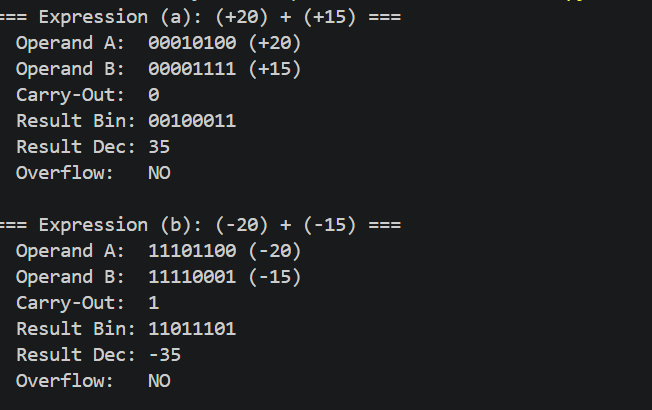
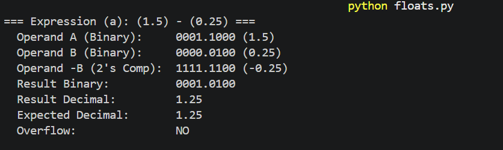

# Bit-Manipulation-

This repository contains simple Python programs developed to simulate low-level computer arithmetic concepts: **8-bit 2's complement integer operations** and **fixed-point binary subtraction**.

## 📁 Repository Structure

```text
├── 8-bit-2.py     # Simulates 8-bit signed integer addition/subtraction using full-adder logic
└── floats.py      # Performs fixed-point floating-point subtraction with binary alignment
```
## 8-bit 2's complement (8-bit-2)
Basic 8 bit addition and subtraction using 2's complement concept. 



## Floating point subtraction
Basic fixed-point binary subtraction (4.4 format) using 2's complement addition (for subtraction) and fixed point representation of the numbers given. 

